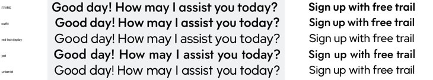
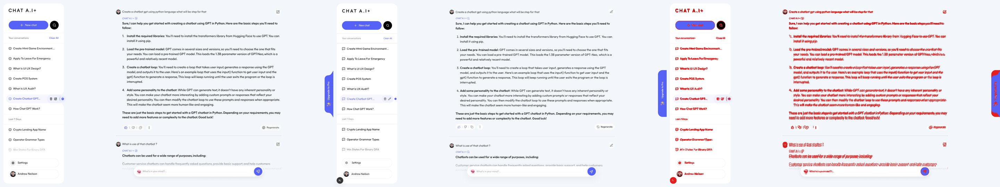
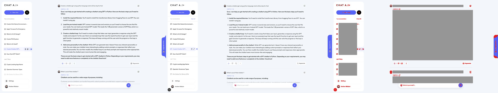
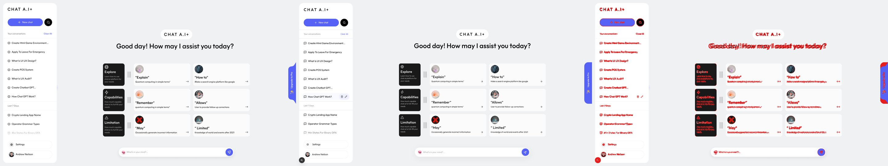
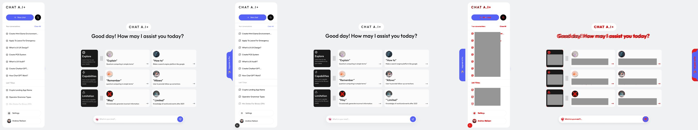
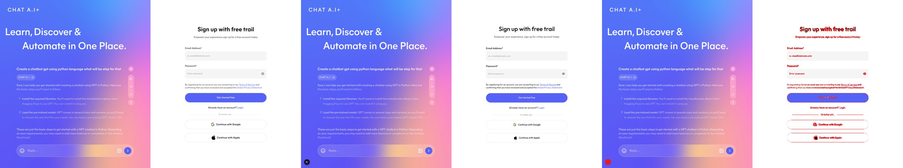

# Design diff — matching the UI to `design/frames/`

How close the running app is to the Figma rasters, measured the same way before and after this branch.

## Method

- Every state renders from fixtures at `/design-states?state=<name>`, shot at 1920×1080, `deviceScaleFactor: 1`.
- `compare-shots.py` (kit `dev:design-ui`) counts pixels that differ by more than the tolerance.
- **Masks** (`design/frames/masks.json`): boxes `[x, y, w, h]` over text the agent or the user writes — answer body, prompt line, conversation titles in the sidebar, suggestion card copy. They are painted grey in both images and left out of the share, so a different sentence does not count as a layout bug.
- **Text styles** (`design/frames/text-styles.json`): what the masks hide is checked for font, size, weight, line height, tracking and colour on the computed style instead (`check-text-styles.py`).
- Masked runs use a 2% threshold; unmasked runs keep the old 3% for comparison.

## Result

| State                                     | Before, unmasked 3% | After, unmasked 3% | After, masked 2% |
| ----------------------------------------- | ------------------- | ------------------ | ---------------- |
| conversation-blue / green / pink / yellow | 6.9%                | 6.8%               | **1.3% PASS**    |
| sign-up                                   | 1.3%                | 1.3%               | **1.3% PASS**    |
| welcome                                   | 3.2%                | 3.1%               | **1.6% PASS**    |
| **Total**                                 |                     | 1/6                | **6/6**          |

The unmasked conversation number barely moves: almost all of it is glyph shapes of a 900px block of answer text, which the mask removes.

### Text styles

| State             | Selectors                                               | Result |
| ----------------- | ------------------------------------------------------- | ------ |
| conversation-blue | answer `p`, answer `strong`, prompt line, sidebar title | PASS   |
| welcome           | sidebar title, heading tile, card title, card prompt    | PASS   |

## Font calibration

The frames are flat rasters, so the font was measured, not read:

1. Render welcome, sign-up and conversation with each of 20 Google font candidates injected.
2. Rank by the error of the ink bounding box (width and height of each text block) against the frame — whole-image pixel diffs barely separate fonts.
3. Confirm the winner on a glyph sheet (`a g y R G 1`).

Outfit came first (box error 10px). Red Hat Display and Urbanist were close on boxes but render visibly lighter. No font change.

## Fixes (token → primitive → screen)

| Element                                 | Before                     | After                  |
| --------------------------------------- | -------------------------- | ---------------------- |
| Form labels (`components/ui/label.tsx`) | 15px                       | 16px, 22px line height |
| Sign-up subtitle / switch line          | 15px                       | 16px                   |
| Consent text                            | 13.5px                     | 14px                   |
| Sidebar logo top / New chat row         | 30px / 46px                | 27px / 47px            |
| Welcome card prompt                     | 13px, `ArrowRight`         | 14px, `MoveRight` 20px |
| Answer toolbar                          | 18px gap above, 16px icons | 21px gap, 18px icons   |
| Prompt edit icon                        | `PenLine` 18px             | `SquarePen` 20px       |

## Narrow widths

welcome, conversation-blue and sign-up at 390 and 768: no horizontal overflow, composer visible.

## Remaining gaps

- welcome heading sits 10px right of the design: the design's heading is not centred on the logo pill.
- sign-up subtitle renders 10px wider; other sign-up offsets ≤3px.

## Images

|              | Before                            | After                            |
| ------------ | --------------------------------- | -------------------------------- |
| conversation |  |  |
| welcome      |            |            |
| sign-up      |                                   |            |
