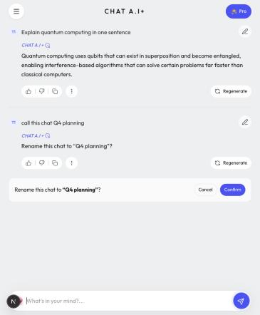
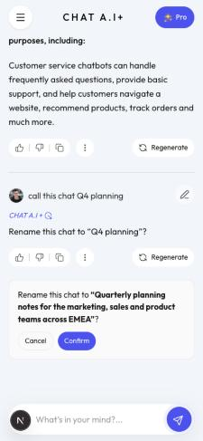
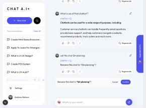

# Demo: a real ticket, start to finish

Ticket: [thanghokdps/chat-bot#1](https://github.com/thanghokdps/chat-bot/issues/1) "Ask the assistant to rename the current chat" ·
Feature PR: [#2](https://github.com/thanghokdps/chat-bot/pull/2) · Follow-up CI PR: [#3](https://github.com/thanghokdps/chat-bot/pull/3) ·
Contract: [`docs/tickets/1/`](../../tickets/1/) · Date: 2026-10-27 · Kit used: agent 5.9.0, dev 4.5.0, ship 4.2.0, core 4.5.0.

## Summary

| Question                      | Answer                                                                                                                                                                                                                                                                                        |
| ----------------------------- | --------------------------------------------------------------------------------------------------------------------------------------------------------------------------------------------------------------------------------------------------------------------------------------------- |
| What was built?               | A user types "call this chat Q4 planning"; the assistant shows a card asking to confirm; on Confirm the chat is renamed. Nothing changes without the click.                                                                                                                                   |
| What did the developer do?    | Typed `/ticket 1`, answered 6 questions (3 design choices, 2 go-aheads, 1 CI choice), merged the PRs. No code written by hand.                                                                                                                                                                |
| How long?                     | 31 minutes from `/ticket 1` to the PR being open; the developer's answers took about 1 minute of that.                                                                                                                                                                                        |
| Is it correct?                | All 8 acceptance criteria have a test and evidence. 214/214 unit and integration tests, 10/10 evals against the real model, checked by hand in the running app at phone and desktop width.                                                                                                    |
| Did review catch anything?    | Yes, one real bug before the PR (invalid tool arguments broke the reply), fixed with a test.                                                                                                                                                                                                  |
| What went wrong?              | PR #2 merged while its `evals` CI job was red. The job failed because the repo had no OpenAI key secret, not because an eval failed. PR #3 makes the job skip with a warning in that case; `main` now requires a PR and a green `checks` job (format, typecheck, lint, tests) before merging. |
| Did the kit work as designed? | The run showed where the kit was loose; those lessons are now in the kit (PRs #36, #37, #39). See "What the kit does now".                                                                                                                                                                    |

## Terms

- **Acceptance criterion (AC)**: one checkable condition the feature must meet. The ticket listed 5; the contract has 8 (below).
- **Contract**: the three files in `docs/tickets/1/` — `intent.md` (the ticket as written), `spec.md` (criteria, API, test plan), `plan.md` (how it was split up). They ship in the same PR as the code.
- **Slice**: one piece of the build (a tool, a UI card…), finished and tested before the next.
- **Eval**: a test that sends a real message to the real model and checks what the assistant does. Costs OpenAI tokens, so it is separate from the unit tests.
- **High-risk lane**: the ticket touches the AI agent and writes data, so the kit stops for the developer's approval of the contract before writing code.

### Why 8 criteria when the ticket had 5

| AC      | From                                                                                                            |
| ------- | --------------------------------------------------------------------------------------------------------------- |
| AC1–AC6 | the ticket's 5 bullets; "propose and confirm, Cancel leaves it unchanged" became AC1 (propose) and AC2 (cancel) |
| AC7     | the developer's answer to question 3 (rename without a title → the assistant suggests one)                      |
| AC8     | added so ordinary questions keep working (the new tool must not fire on them)                                   |

## Timeline (UTC+7)

| Time        | Kit step                  | Result                                                                                   |
| ----------- | ------------------------- | ---------------------------------------------------------------------------------------- |
| 10:33       | Read the ticket           | GitHub issue #1 read: story and 5 criteria                                               |
| 10:34–10:36 | Write the contract        | 3 design questions to the developer; `intent.md`, `spec.md` (8 AC), `plan.md` (6 slices) |
| 10:37       | Approval gate (high-risk) | developer: "approved, start step 3"                                                      |
| 10:37–10:51 | Build                     | 6 slices; evals 10/10; tests 211/211; checked in the running app                         |
| 10:51       | Gate                      | developer: "yes, go on to step 4"                                                        |
| 10:51       | Verify                    | evals, format, typecheck, lint and tests re-run from scratch                             |
| 10:55       | Self-review               | 1 real bug found and fixed with a test; evals 10/10 again; tests 214/214                 |
| 11:03       | Commit                    | code and `docs/tickets/1/` in one commit, `517a214`                                      |
| 11:04       | Open PR                   | PR #2 against `main`                                                                     |
| 11:07       | CI                        | `checks` green; `evals` red (no OpenAI key secret in the repo)                           |
| 11:09–11:10 | Follow-up                 | developer chose "skip evals with a warning when the key is missing" → PR #3              |
| 11:19–11:20 | Merge                     | developer merged #2, then #3; `main` CI green                                            |

## Every question the developer was asked (6)

| #   | When                 | Question                                                                      | Options (★ = recommended)                                                                                                | Answer       |
| --- | -------------------- | ----------------------------------------------------------------------------- | ------------------------------------------------------------------------------------------------------------------------ | ------------ |
| 1   | writing the contract | Where do the confirm step and the rename happen?                              | ★ the assistant only proposes; the existing rename API does the write · the agent pauses on the server and writes itself | ★            |
| 2   | writing the contract | What does the assistant reply when it proposes, or when the title is invalid? | ★ fixed text · the model writes it                                                                                       | ★            |
| 3   | writing the contract | "Rename this chat" with no title?                                             | ★ the assistant suggests one · ask for a title                                                                           | ★            |
| 4   | approval gate        | Approve the contract and start building?                                      | free text                                                                                                                | approved     |
| 5   | step gate            | Go on to checks, review, commit and PR?                                       | free text                                                                                                                | yes          |
| 6   | CI failure           | Evals cost OpenAI tokens. How should CI run them?                             | ★ only on a label · skip when the key is missing · remove the job                                                        | skip (not ★) |

Questions 1–3 each took the developer 4–36 seconds.

## What was delivered

- The contract in `docs/tickets/1/`, committed with the code.
- An architecture decision recorded as ADR 0001 decision 21: the assistant may propose a change, but the write goes through the same authenticated API the sidebar already uses, which checks that the chat belongs to the signed-in user.
- 30 files, +708 / −46: the assistant's `propose_rename` tool, the confirm card in the chat, 2 design-preview states, 3 new evals.

### How it was split (from `plan.md`)

| Slice              | Where it runs                                  | New or changed                                    |
| ------------------ | ---------------------------------------------- | ------------------------------------------------- |
| 1 `propose_rename` | agent: checks the title, never writes          | new                                               |
| 2 answer chunk     | agent: carries the proposal to the server      | changed                                           |
| 3 chat event       | server: sends the proposal to the browser      | changed                                           |
| 4 confirm card     | browser: Confirm calls the existing rename API | new card, existing button, API client and refresh |
| 5 design state     | browser preview page                           | changed                                           |
| 6 evals and docs   | —                                              | changed                                           |

## Evidence

- Tests: 214/214. Evals: 10/10 against the real model after the review fix (7 existing + "rename with a title", "rename without a title", "title too long").
- Running app, signed in as a throwaway local account:
  - an ordinary question → ordinary answer, no card;
  - "call this chat Q4 planning" → card shown, sidebar title unchanged;
  - Confirm → one rename request (200), sidebar shows "Q4 planning" without a reload;
  - "rename this chat" → the assistant suggests a title;
  - Cancel → no request sent.
- Widths: card 343px wide at 375, 556px at 1024, 952px at 1920; no horizontal scroll at any of them.

| Running app                                      | 375, 79-character title                 | 1920                           |
| ------------------------------------------------ | --------------------------------------- | ------------------------------ |
|  |  |  |

## Review findings

Fixed before the PR: when the model called the tool with malformed arguments, the reply was saved as an error, breaking AC4. Now the model retries; a test covers it.

## What the kit does now

This run fed its lessons back into the kit (kit PRs #36, #37, #39, #43). The next ticket runs with:

| Area           | Current behaviour                                                                                                                                                                                                         | Enforced by                                                                                                                                      |
| -------------- | ------------------------------------------------------------------------------------------------------------------------------------------------------------------------------------------------------------------------- | ------------------------------------------------------------------------------------------------------------------------------------------------ |
| Building       | Each slice goes through the specialist skill named in `plan.md`; a real chat turn is checked end to end by `/agent-verify-turn`, not only by hand.                                                                        | `ticket-gate` hook: blocks the commit until every skill on the plan's `Skills:` line ran                                                         |
| Cost           | The strongest model plans and reviews; code is written by a cheaper model from a precise brief.                                                                                                                           | `ticket-gate` hook: blocks the commit until a sonnet or haiku subagent ran                                                                       |
| Lint           | Files change only through the edit tools, so the repo's lint hook runs on every edit.                                                                                                                                     | `edit-guard` hook: blocks shell writes to repo files                                                                                             |
| High-risk work | One process: the contract in `docs/tickets/<id>/`, the developer's approval, then `/security-review` and `/code-review` before the PR.                                                                                    | `ticket-gate` hook: blocks the PR until `/verify-done` and `/review-checklist` ran, plus `/security-review` and `/code-review` when `Risk: high` |
| Merging        | `main` requires a PR and a green `checks` job. Before opening a PR, the kit checks that CI has the secrets it needs and that the branch is protected. Without an OpenAI key, CI skips evals with a warning (chat-bot #3). | GitHub ruleset                                                                                                                                   |
| New tickets    | `/ticket` searches the code first, so it does not propose work that already exists.                                                                                                                                       |
| Git safety     | The guard reacts only to real git commands: it blocks commits and pushes to `main` and environment branches (except the first commit of an empty repo) and adds no delay.                                                 |
| Setup          | New remotes use SSH; the developer's email file is gitignored; the installer shows the right versions and warns when the GitHub and GitLab copies differ; `/sync-remote` ends with a summary.                             |
| Agent writes   | The rule tells two cases apart: the agent writing itself needs a server-side approval step; the assistant suggesting a change the user's click applies does not.                                                          |
| Sessions       | A person opens the Claude Code session and types `/ticket <id>`; a remote session cannot open one.                                                                                                                        |

The first five rows are blocked by a hook or by GitHub, not left to the model (kit PR #43). A check that does not apply is waived only by a line `skip /<skill>: <reason>` in the ticket's `plan.md`, so the reason shows in the PR.
